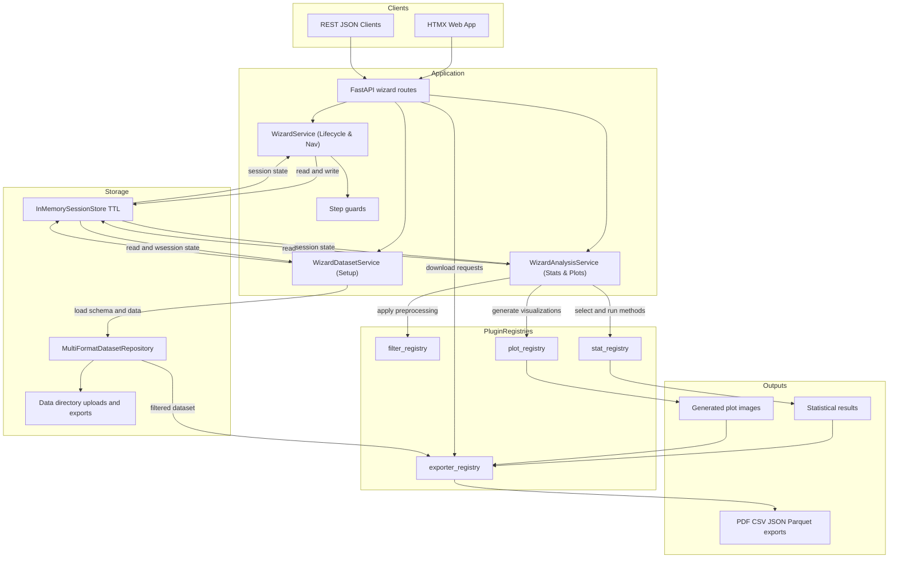

# ExPyRi — Experiment Evaluation Wizard

*Note: This project was formerly known as ExpYT.*

[](https://github.com/Kugeleis/expyri/actions/workflows/ci.yml)
[](https://kugeleis.github.io/expyri/)
[](https://github.com/Kugeleis/expyri/actions/workflows/github-code-scanning/codeql)
[](https://www.python.org/downloads/)

ExPyRi is a modular, extensible FastAPI backend that guides users through a multi-step statistical evaluation wizard: **Dataset Selection → Preprocessing Filters → Statistical Method → Run Evaluation → Plot Selection → Report Export**.

The project is built on SOLID open/closed principles, allowing developers to add new filters, statistical methods, plots, and exporters as plugins without modifying the core API router or orchestration logic.

---

## Architecture Diagram

The wizard maintains state using an in-memory session store (interfaced via a protocol dependency, allowing easy swap to Redis/DB). Datasets are loaded through a repository abstraction, and each stage is guarded by step prerequisites. Applicability guards query registries to list options suited to the dataset's current characteristics (e.g., number of groups, normality, homogeneity of variance).



---


---

## Getting Started

### Prerequisites

- Python 3.14
- [uv](https://github.com/astral-sh/uv) (Python package manager)

### Installation
Clone the repository and synchronize the environment:
```bash
uv sync
```

### Running the App Locally (Development)
Start the FastAPI server with auto-reload:
```bash
task dev
```
The documentation will be available at `http://127.0.0.1:8765/docs`.

### Running with Docker
The Docker image is based on Astral's uv Python 3.14 slim image, `ghcr.io/astral-sh/uv:0.11.26-python3.14-trixie-slim`.

Build the image locally:
```bash
docker build -t expyri .
```

Run ExPyRi on port 8765 with a persistent data directory:
```bash
docker run --rm -p 8765:8765 -v "$PWD/data:/app/data" expyri
```

The container sets `EXPYRI_DATA_DIR=/app/data`. Uploaded datasets are stored in that directory, and generated Parquet exports are written under `/app/data/exports`. Mounting a host directory or Docker volume at `/app/data` keeps uploads and exports across container restarts.

The image runs as a non-root user with UID/GID `1000` by default so typical Linux bind mounts are writable. If your host user has a different ID, rebuild with matching IDs:
```bash
docker build --build-arg UID="$(id -u)" --build-arg GID="$(id -g)" -t expyri .
```

Convenience tasks are also available:
```bash
task docker:build
task docker:run
```

### Running with Docker Compose
Alternatively, run the application using Docker Compose:
```bash
docker compose up --build -d
```

### GHCR Image
Published images are available from GitHub Container Registry:
```bash
docker pull ghcr.io/kugeleis/expyri:edge
docker run --rm -p 8765:8765 -v "$PWD/data:/app/data" ghcr.io/kugeleis/expyri:edge
```

Image tags are published as follows:

| Tag | Meaning |
|---|---|
| `edge` | Latest image built from the `master` branch |
| `sha-<commit>` | Immutable image for a specific commit |
| `<version>`, `<major>.<minor>`, `<major>` | Semver tags created from version tags such as `v0.7.1` |
| `latest` | Latest version-tagged release image |

---

## UI Usage Guide

ExPyRi guides you through a step-by-step statistical evaluation wizard. Here is an extensive guide on how to use the UI, along with the statistical concepts and references underpinning each step:

### Step 1: Select Dataset & Column Mapping

1. **Upload / Select Dataset**: Upload your experiment data in `.csv`, `.xpt`, `.h5`, or `.parquet` format.
2. **Set Group Column**: Select the discrete column representing the treatment group or experimental arm.
3. **Map Metrics**: Check the continuous and discrete metric columns you wish to analyze.
4. **Hierarchical Toggle (Optional)**: If your observations are nested (e.g., measurements grouped in batches, wafers, or clusters), enable **Hierarchical Data Support**.
   - **Cluster Column (L1)**: Select the grouping variable for intermediate clusters (e.g., wafer, class, clinic).
   - **Unit Column (L0 - Optional)**: Select the column for unique unit IDs (defaults to "None" which uses the row index).
   - **Spatial Coordinates (Optional)**: Select the optional X and Y coordinate columns to enable spatial heatmap plotting.

---

### Step 2: Configure Preprocessing Filters
Add one or more filtering criteria to slice and clean the dataset before running tests:

- **Numeric Range**: Keep only observations within specified bounds.
- **Category Filter**: Include or exclude specific discrete classes.
- **Cluster Exclusion**: Exclude entire intermediate clusters (L1) from hierarchical analysis (useful for removing defective batches or outlier groups).

---

### Step 3: Statistical Method Selection
The wizard queries the backend to determine which methods are applicable based on automated tests of your filtered dataset's properties:

#### Continuous Variable Methods

- **[Independent Two-Sample t-Test](https://en.wikipedia.org/wiki/Student%27s_t-test)**: Compares means of exactly 2 groups. Requires normality and homogeneous variance.
- **[One-Way ANOVA](https://en.wikipedia.org/wiki/One-way_analysis_of_variance)**: Compares means across 3 or more groups. Requires normality and homogeneous variance.
- **[Mann-Whitney U Test](https://en.wikipedia.org/wiki/Mann%E2%80%93Whitney_U_test)**: Non-parametric comparison of 2 groups. Used when normality is violated.
- **[Kruskal-Wallis H Test](https://en.wikipedia.org/wiki/Kruskal%E2%80%93Wallis_one-way_analysis_of_variance)**: Non-parametric comparison of 3 or more groups. Used when ANOVA assumptions fail.

#### Clustered / Hierarchical Methods

- **[Linear Mixed Model (LMM)](https://en.wikipedia.org/wiki/Mixed_model)**: Evaluates fixed group effects while modeling random intercepts for clusters to account for intra-cluster correlation.
- **Cluster Mean ANOVA / Kruskal-Wallis**: Aggregates unit observations to cluster-level means before running ANOVA or Kruskal-Wallis, mitigating false significance due to pseudoreplication.
- **Proportion Kruskal-Wallis**: Evaluates binary proportion outcomes aggregated at the cluster level.

#### Discrete Variable Methods

- **[Chi-Square Test of Independence](https://en.wikipedia.org/wiki/Chi-squared_test)**: Evaluates association between categorical variables.

---

### Step 4: Run Evaluation & Review Results
Executes the selected methods and shows an interactive results table containing:

- **Test Statistic**: The calculated value (e.g., $t$, $F$, $H$, $\chi^2$, or $z$).
- **p-value**: Statistical significance. Cells are highlighted green if $p \le 0.01$ (strict significance) or yellow if $p \le 0.05$.
- **Effect Size**: Quantitative measure of the magnitude of the experimental effect.
- **[Intraclass Correlation (ICC)](https://en.wikipedia.org/wiki/Intraclass_correlation)** (Hierarchical only): Indicates the proportion of total variance explained by the clustering level.
- **Statistical Warnings**: Alerts you if assumptions are violated (e.g., severe non-[normality](https://en.wikipedia.org/wiki/Shapiro%E2%80%93Wilk_test), [heteroscedasticity](https://en.wikipedia.org/wiki/Levene%27s_test), or the presence of significant [outliers](https://en.wikipedia.org/wiki/Grubbs%27s_test_for_outliers)).

---

### Step 5: Plot Selection & Preview
Select visualizations to generate for your report. The UI renders live previews using:

- **Box Plot / Violin Plot**: Visualizes group distribution, medians, and quartiles.
- **ECDF (Empirical Cumulative Distribution Function)**: Plots cumulative distributions to compare group spreads.
- **Cluster Mean Bar Plot** (Hierarchical): Displays group means of cluster means with error bars.
- **Cluster Spatial Heatmap** (Spatial): Facilitates spatial pattern analysis by mapping metric values onto X/Y grid coordinates.

---

### Step 6: Export Report
Download your final results and plots in one of these structured formats:

- **PDF Report**: A publication-ready document compiling the test description, evaluation table, decision flags, and embedded high-resolution figures.
- **CSV / JSON Exports**: Standardized raw outputs of the statistical results for downstream pipelines.
- **Interactive Explorer (Parquet with Metadata)**: Launches a Marimo notebook instance preloaded with your preprocessed dataset saved as a `.parquet` file. This Parquet file contains extensive session metadata stored in its schema metadata headers, allowing full reproducibility of the ExPyRi session.

#### Parquet Metadata Structure
When the Interactive Explorer is selected, ExPyRi writes the cleaned dataset and all execution metadata directly to the Parquet file's schema metadata headers (as JSON-encoded UTF-8 bytes). This makes all choices and info from ExPyRi fully reproducible.

The Parquet file contains the following custom metadata keys:

| Key | Description | Format |
|---|---|---|
| `dataset` | The ID/name of the source dataset | String |
| `timestamp` | Time when the explorer was launched / file was generated | ISO 8601 UTC string |
| `selected_statistical_methods` | Selected statistical method names | Object (e.g. `{"continuous": "...", "discrete": "..."}`) |
| `statistic_results` | Full array of computed statistical test results | Array of result objects |
| `plots_selected` | Names of the plots chosen for export | Array of strings |
| `session_id` | Unique ID of the ExPyRi session | String |
| `group_column` | The chosen grouping column | String |
| `selected_value_columns` | Numeric metric columns selected | Array of strings |
| `selected_discrete_columns` | Categorical metric columns selected | Array of strings |
| `selected_groups` | Groups selected for comparison | Array of strings |
| `filters_config` | Preprocessing filters applied | Array of filter configuration objects |
| `plot_results` | Generated plot metadata | Array of plot result objects |
| `hierarchy` | Hierarchical config settings (if hierarchical mode is enabled) | Object or `null` |
| `excluded_clusters` | Hierarchical clusters excluded from analysis | Array of objects or `null` |

---

## Development Workflow & QA

Quality gates are strictly enforced. All tasks can be run via the task runner:

| Command | Description |
|---|---|
| `task install` | Installs dependencies |
| `task lint` | Runs `ruff check` and `ruff format --check` |
| `task format` | Auto-formats code with `ruff` |
| `task typecheck` | Runs `ty` type checks on code |
| `task test` | Runs the test suite with coverage check (>90% required) |
| `task check` | Runs all quality gates (lint -> typecheck -> test) |
| `task bump -- <patch/minor/major>` | Bumps the application version using `bump-my-version` |

### Project Directory Layout

<details markdown="1">
<summary>Click to expand directory layout</summary>

```text
├── app/                      # Core FastAPI web application
│   ├── core/                 # Session models, storage interfaces, and TTL cleanup
│   ├── datasets/             # Dataset loading and schema repositories
│   │   ├── models.py         # Dataset Pydantic models
│   │   ├── repository.py     # Dataset loader and repository classes
│   │   └── utils.py          # Column resolution helper functions
│   ├── exporters/            # Extensible export plugins (CSV, JSON, PDF)
│   ├── filters/              # Extensible preprocessing filters (numeric range, category)
│   ├── main.py               # Application factory and lifespan setup
│   ├── plots/                # Extensible plot generators (boxplot, ECDF, violin)
│   ├── static/               # Client-side static assets (Pico CSS, simple JS helpers)
│   ├── stats/                # Extensible statistical plugins (t-test, ANOVA, LMM, etc.)
│   ├── templates/            # Jinja2 HTML templates
│   │   ├── base.html         # Main page frame layout
│   │   ├── layouts/          # HTMX Out-of-Band composition layouts
│   │   └── partials/         # Step-specific and sidebar layout partials
│   └── wizard/               # Router endpoints, request schemas, and transition controls
│       ├── router/           # Endpoint controllers for HTMX, JSON, and compatibility
│       ├── service.py        # Centralized WizardService (lifecycle, navigation, filters)
│       ├── dataset_service.py # WizardDatasetService (dataset selection, column mapping)
│       ├── analysis_service.py # WizardAnalysisService (stats execution, plotting preview)
│       ├── schemas.py        # Pydantic schemas for JSON payloads
│       └── steps.py          # Step sequence, guards, and transition definitions
├── test_data/                # CSV datasets used for verification (e.g., nycflights.csv)
└── tests/                    # QA verification suite (unit, integration, and end-to-end)
```
</details>

---

## Extensibility: Adding Custom Plugins

Adding a new plugin requires **zero changes** to core routing or session orchestration. Simply define a subclass and register it with the appropriate decorator.

### 5-Line Recipe Example

Here is how you can add a custom statistical method in under 10 lines:

```python
from app.stats.base import DataProperties, StatMethod, StatResult, stat_registry


@stat_registry.register("zscore_outliers")
class ZScoreOutliersMethod(StatMethod):
    name = "zscore_outliers"
    description = "Checks for outlier points using Z-score."

    def is_applicable(self, properties: DataProperties) -> bool:
        return properties.n_groups >= 1

    def run(self, groups) -> StatResult:
        # custom calculations...
        return StatResult(
            method_name=self.name,
            test_statistic=1.96,
            p_value=0.05,
            effect_size=None,
            summary="Completed outlier check.",
        )
```

The system will automatically:

1. Discover the plugin at startup (under `app/stats/builtin` or when imported).
2. Include it in the `GET /wizard/sessions/{id}/methods` response if `is_applicable` returns `True`.
3. Accept it in `POST /wizard/sessions/{id}/method` and run it during `GET /wizard/sessions/{id}/results`.

The same recipe applies to:

- **Filters**: Inherit `Filter`, register to `filter_registry`.
- **Plots**: Inherit `PlotGenerator`, register to `plot_registry`.
- **Exporters**: Inherit `Exporter`, register to `exporter_registry`.

---

## Statistical Method Selection

In Step 3, the wizard dynamically queries the backend to determine which statistical methods are applicable to your filtered dataset. This process relies on automated data property computation and applicability rules:

### 1. Data Properties Auto-Computation
When navigating to Step 3, the backend evaluates the dataset properties for each selected dependent column:

*   **Normality (`Shapiro-Wilk`)**: Assessed per treatment group. Normality is satisfied if the test p-value $p > 0.05$ for all groups.
*   **Variance Homogeneity (`Levene's Test`)**: Assessed across all groups. Homogeneity is satisfied if $p > 0.05$.
*   **Sample Count (`n_groups`, `min_n_per_group`)**: Captures group size and count constraints (e.g. at least 2 observations per group are required for standard variance-based tests).
*   **Hierarchy Clustered Data**: If Hierarchical Support is enabled, these statistical properties are calculated on the aggregated cluster means rather than individual unit observations to prevent pseudoreplication bias.

### 2. Method Preconditions (`is_applicable`)
Each statistical plugin implements `is_applicable(properties) -> bool` to declare its statistical assumptions:

*   **Independent Two-Sample t-test**: Requires exactly 2 groups of numeric data, $n \ge 2$ per group, normality satisfied, and homogeneous variance.
*   **One-way ANOVA**: Requires $\ge 2$ groups of numeric data, $n \ge 2$ per group, normality satisfied, and homogeneous variance.
*   **Mann-Whitney U**: Non-parametric; requires exactly 2 groups of numeric data with $n \ge 2$ per group.
*   **Kruskal-Wallis H**: Non-parametric; requires $\ge 2$ groups of numeric data with $n \ge 2$ per group.
*   **Linear Mixed Model (LMM)**: Hierarchical; requires clustered data configuration and continuous metric.
*   **Chi-Square Test**: Categorical; requires discrete/binary columns with expected cell counts $\ge 5$ in the contingency table.

### 3. Multiple Column Selection Intersection
If multiple dependent variables/metrics are selected for evaluation:
*   The wizard calculates properties for **each** column independently.
*   It then intersects the sets of applicable methods (`get_applicable_intersect`).
*   A statistical method is offered in the UI **only if it is applicable to all selected columns**. For example, if you select one normal column and one highly skewed column, parametric tests like the *t-test* or *ANOVA* will be filtered out because they violate the assumptions of the skewed column; only non-parametric alternatives (like *Mann-Whitney* or *Kruskal-Wallis*) will be offered.

---

## Hierarchical Data Processing

<details markdown="1">
<summary>Hierarchical Data Support Logic Details</summary>

### Overview
When "Enable Hierarchical Data Support" is toggled, ExPyRi switches from flat independent evaluation to hierarchical/nested/clustered evaluation. The data levels are defined as:

- **Level 2 (Group)**: Treatment group / experiment arm (discrete)
- **Level 1 (Cluster)**: Intermediate cluster / experimental unit (discrete)
- **Level 0 (Unit)**: Individual observations (lowest level)

### Column Types and Validation
Only continuous and binary proportion dependent columns are supported in hierarchical mode. Multi-class categorical columns (e.g. string columns like `dest` with multiple classes) are not supported.

- **Continuous Columns**: Real-valued numeric measurements.
- **Binary Proportion Columns**: Numeric or boolean columns containing values restricted to `{0, 1, True, False}`.
- **Unsupported Columns**: Non-numeric, non-binary columns. These are classified as `"unsupported"` on the backend and automatically deselected during hierarchical setup, preventing downstream exceptions or crashes.

### Execution Flow

1. **Aggregates Computation**: Cluster-level aggregates (`mean`, `std`, `proportion_corrected`, etc.) are computed.
2. **Properties Auto-Computation**:
   - Normality check (Shapiro-Wilk) is run on the cluster means (not unit observations).
   - Variance homogeneity (Levene's test) is run on the cluster means.
   - Outliers are identified via Grubbs test on cluster means.
   - Intra-class Correlation (ICC) is computed using a Linear Mixed Model (LMM).
3. **Method Selection**: The wizard filters applicable hierarchical methods (e.g., LMM, Cluster Mean ANOVA, Cluster Mean Kruskal-Wallis, or Proportion Kruskal-Wallis).

### Spatial Coordinates (Optional)
If your dataset contains spatial coordinates for each observation (e.g., $X$ and $Y$ coordinates of chips on a wafer in semiconductor manufacturing), you can select the corresponding columns under:

- **X Spatial Coordinate (Optional)**
- **Y Spatial Coordinate (Optional)**

#### What is done with this data?

1. **Exclusion from Metrics**: Like group, cluster, and unit columns, the selected spatial coordinate columns are automatically excluded from the list of analyzed continuous/discrete metrics to avoid redundant evaluation.
2. **Enables Spatial Visualization**: Specifying both $X$ and $Y$ coordinates flags the session as having spatial coordinates (`has_spatial_coords = True`). This enables the **Cluster Spatial Heatmap** (`cluster_spatial_heatmap`) generator in Step 5 (Plot Selection). This plot renders a grid heatmap of unit values plotted against their $X$/$Y$ spatial coordinates, side-by-side (faceted) for each treatment group, letting you easily identify spatial patterns or defects.
</details>
